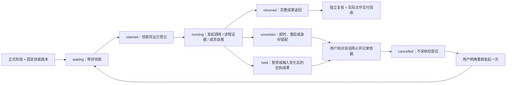

# 第二迭代：执行治理与阶段技能

2026-10-18。需求与架构见 `PLAN-iteration2-execution-governance.md`；本轮经用户 Confirm Development 后实施。

## 使用入口

- 项目中心 → 协作任务 → 项目房间 → **执行记录与技能**：暂停/明确继续工作链、配置阶段技能、查看执行时间线、返回内容及核对旧执行。
- Agent 中心 → 成员：分开展示通道证据、最近执行尝试和阻塞原因。普通留言旁的**转为正式任务**先预览，再明确创建一条保持暂停的协作任务。
- 刷新、查看时间线、技能选择和转换预览都不发起模型调用。明确继续仅解除本项目的自动接力暂停；不会恢复归档记录或 WorkBuddy 的定时任务。

## 数据与状态

唯一台账继续为 `data/store.json`。新增 `executionAttempts` 保存尝试、输入哈希、明确技能版本、领取凭证、事件、完整返回文本及其哈希；`executionCommands` 保存操作幂等回执。既有 jobs 通过 attemptId 引用本次尝试，业务阶段与最终交付仍由原流程判断。不另建任务数据库，不迁移或重跑历史记录。

`running` 本身不证明模型成功。`startedEvidence.source=process-event` 只证明执行器进程启动；`member-self-report` 是成员自报开始，页面明确区分。未拿到证据时显示“尚无开始证据”。`returned` 不等于正文通过或文件交付完成；`adopted=unknown` 不冒充实际采用技能。

`failed` 为有明确失败证据的尝试；已经启动但结果不明的错误、租约超时和结果身份错配为 `uncertain`。重启时：未领取且未调用的等待项标 `interrupted`，已领取或已发起的标 `uncertain`。不会自动重放。旧协议作业只能展示其原始状态，细分事实标为未核实。

## 准入、输入与归属

`lib/execution-governance.js` 统一准入、领取、调用、结果收编、恢复与技能核验。Codex、Cursor、WorkBuddy、通用模型执行、项目群聊、准备材料接力和补交文件复核接入；技能工作室测试也参与同一成员的占用检查。

- 每位成员同时最多一个有效执行；每个阶段只有一个 `activeAttemptId`。旧回调不得清理或覆盖后来尝试的阶段。
- 同一成员、阶段、用途及输入哈希最多三次尝试，所有入口共同约束。复核返工继续受既有每轮三次真实退回上限约束；只有原有明确恢复入口可以开启下一有界轮次，保留历史基线。
- 暂停、归档、恢复、批准、改派、任务说明及技能绑定变更会改变控制代数或输入快照。提交前、领取前、调用前及结果收编前再次检查。暂停后又恢复也不能收编旧结果。
- 群聊可以在工作链自动接力暂停期间讨论，但不推进业务、不批准写作；仍遵守 Agent/WorkBuddy 通道暂停及占用限制。
- 结果不确定、有效领取过期或迟到结果先核对，不以“锁够旧”或“没收到结果”判断从未执行。核对必须确认旧会话已停止、提供依据并绑定当前结果哈希；本期只支持不采纳旧结果，随后明确重新发起，不自动套用不确定成果。
- 同一幂等键和内容返回同一回执；冲突内容拒绝。页面在请求失败时保留待完成操作的键；领取重试不会生成另一份归属。幂等凭证用于防止意外重复，不宣称为本机多进程之间的完整认证隔离。

时限：Codex 正式阶段领取租约六分钟、CLI 自身通常四分钟；Cursor 十分钟；WorkBuddy 桌面等待一百三十分钟，保留每小时领取窗口。页面展示实际领取有效期。超时不自动重发。实际模型用量不能取得时显示未知，不表示为零。

## 本机接口

| 接口 | 作用 |
|---|---|
| `GET /api/departments/runs/:id/execution` | 只读执行时间线、阶段绑定、旧作业及通道证据 |
| `POST .../execution/control` | `{action:pause\|resume, expectedGeneration, idempotencyKey}` |
| `POST .../execution/skills` | `{stepId, bindings:[{skillId,versionId,contentHash}], expectedGeneration, idempotencyKey}` |
| `POST .../execution/started` | `{attemptId,claimId,inputHash,idempotencyKey}`；只登记成员自报 |
| `POST .../execution/result` | `{attemptId,idempotencyKey}`；只读完整返回内容，不采纳成果 |
| `POST .../execution/reconcile` | `{attemptId,resultHash,confirmed:true,stopped:true,evidence,resolution:"do-not-apply",idempotencyKey}` |
| `POST .../execution/retry` | `{attemptId,resultHash,confirmed:true,idempotencyKey}`；须为本阶段最近的已失败/中断/已核对尝试，遵守预算与准入 |
| `POST /api/inbox/:id/convert/preview` | 填写目标、交付物、验收要求、负责人、独立复核人及可选类型化关联项目；返回 snapshot |
| `POST /api/inbox/:id/convert` | 同一预览输入 + `{snapshot,confirmed:true,idempotencyKey}`，创建一次暂停任务 |
| `POST /api/workbuddy/claim` | `{workerId,idempotencyKey}`；锁内校验台账后返回 assignment |

写入及结果预览均限定本机；收到完整 HTTP 请求体后再读取最新台账进行检查和同步提交。`control` 不恢复归档暂停，也不操作外部调度。

普通留言转换保留原文与状态，写入 `convertedRunId`；工作链记录 `sourceInboxId` 和明确的 `parentProjectRef {kind:module|department-run,id}`。不按名称合并业务项目，不视为 Start Writing，也不启用自动接力。

## WorkBuddy 桌面协议 v2

`scripts/workbuddy-queue.js` 正常执行时先请求本机领取接口；不再从队列文件自行取得执行授权。只有台账确认后才返回 prompt 和结果路径。队列 request 关联 jobId、attemptId、claimId、inputHash。成员实际开始时按领取提示运行同一脚本 `started <jobId>`，登记自报回执；这不等同于独立运行证据。

结果必须包含准确的 `{jobId,agentId:"workbuddy",attemptId,claimId,output}`；错配不推进阶段，保留原文件供核对。v1 文件仍可供历史读取，不可通过 v2 正式领取接口绕过凭证。领取后响应丢失可用同键核对；已返回、已核对或不确定的尝试不会重新发出可执行 assignment。

文件队列与台账不是一个跨文件原子数据库。若台账已登记领取而文件写入/响应失败，可能留下已领取但无可执行回执的尝试：不返回执行任务，不重复放行，用户在时间线核对实际会话后恢复。锁文件不按年龄自动移除。核对确认后仅将对应 request 标为 cancelled，不删除成果或历史。

**当前 WorkBuddy 定时领取仍为用户主动暂停；本轮没有恢复、修改自动化数据库或做真实 WorkBuddy 执行验收。**

## 阶段技能

只绑定自有、用户已确认发布且允许该阶段成员使用的版本。启动和收编检查实际 Markdown 哈希，缺文件、改动、停用或成员不符时阻止；版本更新不会替换已经固定的输入。技能正文只注入当次任务，不修改任何成员的全局技能或规则。发布和独立技能测试仍沿用第一迭代规范。

## 验证记录

| 验证 | 结果及限制 |
|---|---|
| `test/execution-governance.test.cjs` | 暂停领取、暂停恢复后迟到结果、幂等归属、到期不重发、重启核对、三次预算及旧回调隔离通过；合成执行器 |
| `test/execution-api.test.cjs` | 旧入口暂停门禁、实际技能文件注入、幂等操作、暂停转换、桌面领取/自报/错误凭证、只读刷新通过；真实 Agent 调用为零 |
| `test/desktop-bridge.test.js` | v1 兼容、v2 精确领取回执、无领取结果拒绝、重复和超时通过 |
| `test/execution.browser.cjs` | 显式操作、绑定草稿、返回内容安全显示、核对、转换、中英文、四主题、窄屏及刷新不执行通过 |
| `test/execution-live.cjs` | 仅显式设置 `BENCH_REAL_CODEX=1` 才执行；本轮一条真实 Codex ChatGPT 调用已返回，精确技能版本、进程启动、标记及完整结果均核对；只完成隔离样例主管阶段，后续成员未启动 |
| 原有全部回归 | `npm test`、`npm run test:agents`、`npm run test:ui`；最终运行结果见本次本机验收记录 |

真实样例证据保存在忽略提交的 `data/acceptance-iteration2/`；不得将它、生产台账、凭据、队列或业务文件加入提交。上述 Codex 样例不证明 WorkBuddy/Cursor 全链路真实验收。VaultRAG 生产设置未改变，正式任务依赖仍按原政策处理；本期不启动 Docker、修复资料服务或建立知识索引。

本机加载状态：开发验收完成，自动重启原工作台服务被执行策略拒绝，未停止该进程。需要用户通过原方式重启服务后，再核验生产接口；不能把隔离测试通过写成本机服务已经更新。
