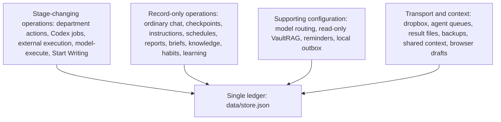
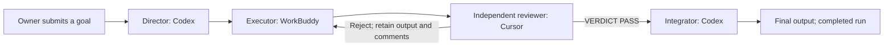
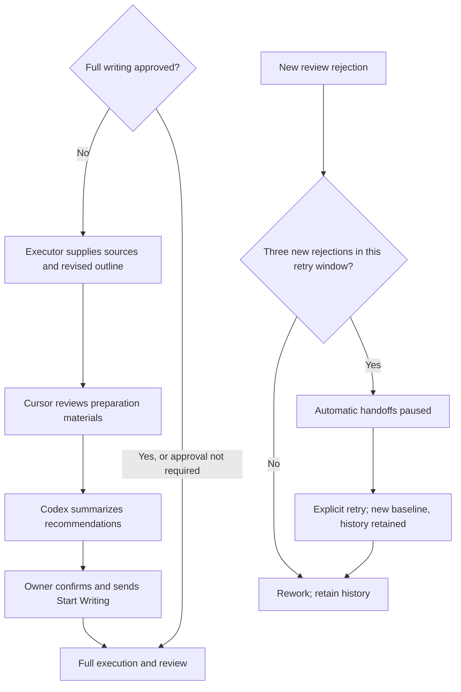
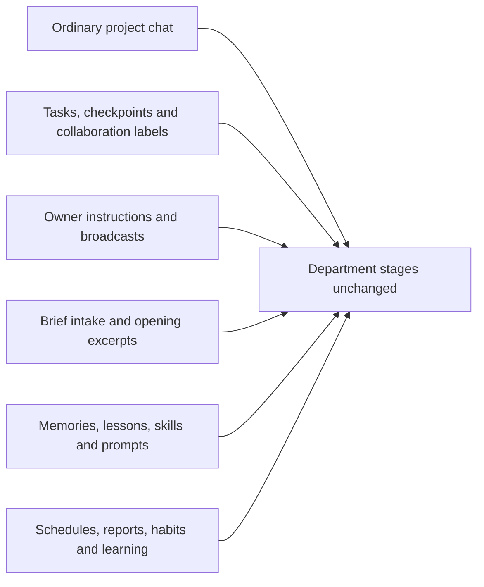
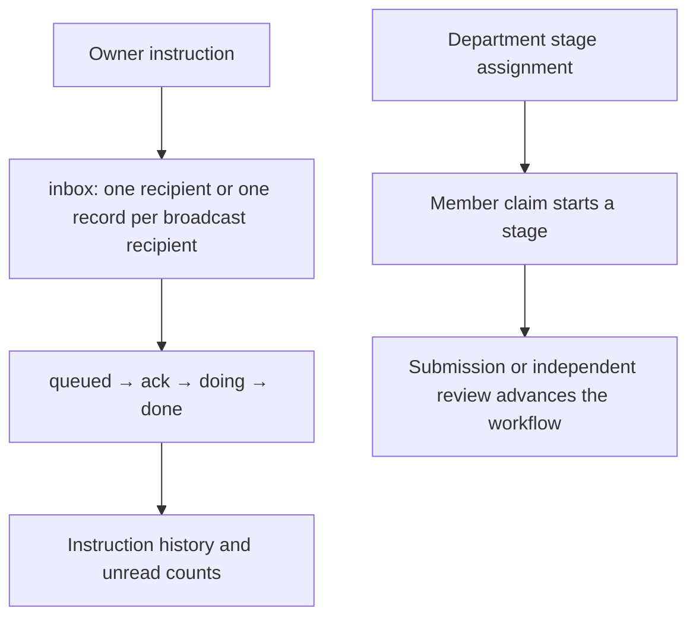
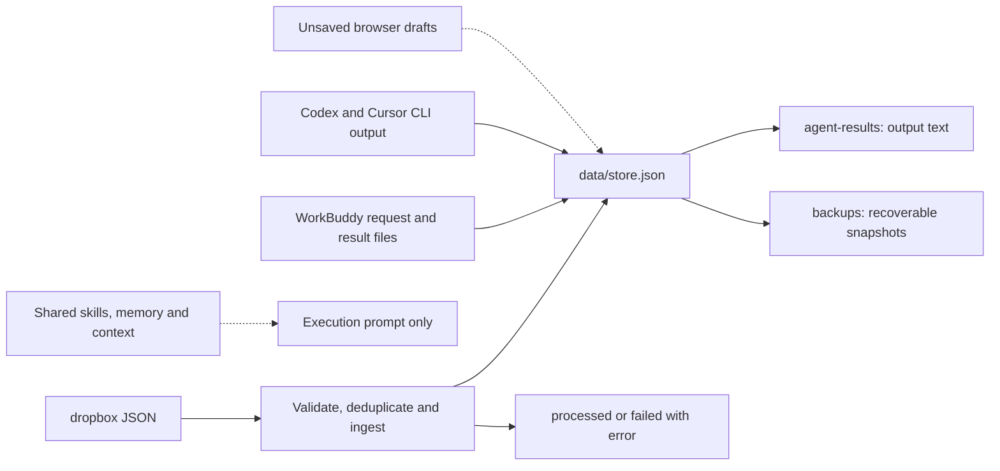
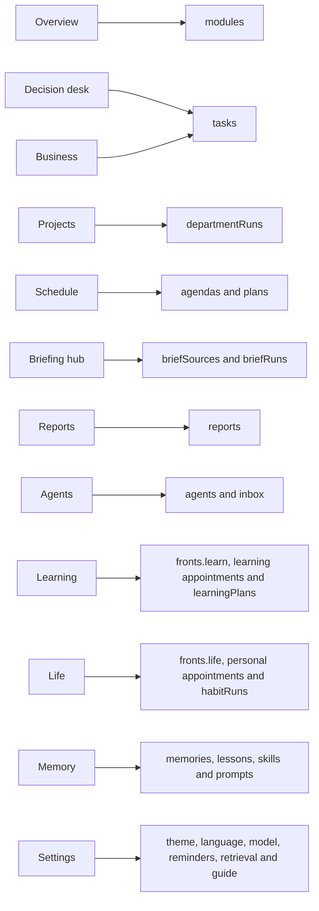
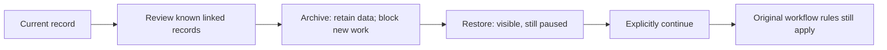

# Type 1 workbench: complete logic map

This map covers every subsystem. The four-stage department workflow is one execution path within the workbench. The single source of progress is data/store.json. Queues transport requests and results; backups and shared context are not separate progress ledgers.

## 1. Subsystems and the ledger

All twelve pages read the same ledger. A saved message, a checkpoint, a connection test and accepted business output have different meanings.

## 2. Department workflow

With the three selected participants, Codex plans, WorkBuddy executes, Cursor independently reviews, and Codex integrates. The executor and reviewer must differ.

Stage states are blocked, queued, doing, done and rework. Run states are planning, active, rework and completed. Archiving is an independent flag, not a completion state.

Start Writing opens the writing gate; it does not clear an existing automation pause. Preparation output is not final business acceptance. A retry window allows three new rejections, while historical comments remain available.

The service checks business handoffs every five seconds and chat every two seconds. WorkBuddy uses a separate hourly desktop queue. Failed jobs do not retry forever. A restart records interrupted calls and makes the affected stages available again. Existing jobs may still finish after archiving; their output is retained in job history without advancing stages.

## 3. Record operations and instructions

Only owner messages with chat: true enqueue member replies. Explicit mentions take precedence; Codex is the default recipient. Replies are stored in projectMessages.replyTo and chatJobs. A member reply does not automatically summon other members. WorkBuddy discussion and business execution share its queue, but ordinary discussion can run while review automation is paused. Archived or restored-but-paused projects cannot claim either kind of work.

Collaboration labels lead, collab, split and lead-review describe a task; they do not create four department stages. Stage discussion, project chat, run material paths and artifact registrations are separate records.

## 4. Files and evidence

Results and queued files are transports, not a second ledger. Shared context does not merge agents’ private memories. A browser draft enters the ledger only after submission or adoption. Original materials remain at their registered paths.

## 5. Collections and supporting services

- departmentRuns holds goals, stages, review history and final output. codexJobs and externalJobs track real execution.
- chatJobs and projectMessages track discussion. Ordinary replies do not advance stages; an owner message ending with Start Writing can authorize writing.
- tasks, inbox, specs, memories, lessons, prompts, skills, reports, plans, agendas, briefSources and briefRuns hold their respective records.
- agents, modules and fronts supply members, overview cards and work/learning/life tracks. lifeSystem holds habit templates, habit history and adopted learning plans.
- events records changes. artifacts registers output, versions and review metadata without itself advancing stages.
- remote contains model, knowledge-library and reminder configuration. Slack and Telegram currently provide local configuration/outbox placeholders, not proven delivery.
- domains supplies report names. The legacy pipeline and top-level sessions fields are not read by normal pages or the service.

Opening briefs combine operating summaries, agent summaries, work/learning/life and external sources. Brief delivery deduplicates by source and externalRunId or matching content fingerprint.

The seven report types are daily, retro, guidance, weekly, assessment, monthly and quarterly. Draft generation does not mean acceptance. Archived or paused tasks are excluded from current operating statistics; archiving does not mark completion.

Task warnings use twenty-four hours without a checkpoint; member warnings use forty-eight hours without lastSync. A fleet sync updates timestamps rather than completing department stages. Important appointments have a separate twelve-hour reminder, disabled unless configured.

Model routing supports decomposition and draft generation. The three-agent handoff instead uses Codex’s local ChatGPT CLI, Cursor Agent CLI and WorkBuddy’s desktop queue. VaultRAG is read-only: failed retrieval can still allow planning with a missing-evidence notice, but review retrieval failure blocks that review. Retrieval excerpts do not prove completed work. The isolated enterprise-WeChat probe is not the production execution path.

## 6. Page-to-data map

## 7. Archiving and explicit continuation

Archiving preserves status, history and material paths. Restoring an executable record does not restart it. Explicit continuation retains a review pause that existed before archiving; its normal retry and writing-approval rules still apply. Disabling a member with active assignments requires reassignment or archiving those assignments first. External agent conversations and schedules remain managed in their original applications.

The original Chinese map documents three implementation distinctions: explicitly choosing the three participants differs from legacy automatic member preferences; ordinary chat differs from the Start Writing authorization exception; retry baselines differ from lifetime rejection history. The current code is authoritative when older handover text differs.
