# 类型 1 工作台全图

这张图覆盖本机统筹工作台的全部子系统。虚拟部门的「主管 → 执行 → 独立复核 → 整合」只是其中一条会推动岗位的工作链。

依据是现行源码和 `docs/交接`（2026-10-18 导航与状态语义核对），不使用 `docs/交接/source-snapshot`，也不摘录 `data/store.json` 里的正文、密钥或凭据。唯一进度在 `data/store.json`。旁边的文件要么被收编进这份台账，要么只做传输和备份，不另记一份进度。

## 1. 总览：每个子系统怎么接到唯一台账

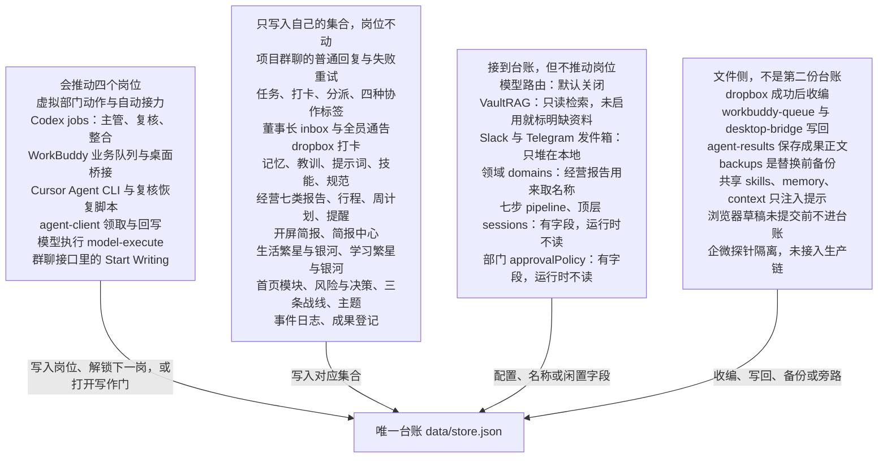

左栏十个入口都读这一份台账：首页、项目中心、Agent 中心、每日行程、简报中心、工作报告、资产中心、学习、生活、设置。风险与决策属于首页；业务项目与协作任务属于项目中心，保留不同记录身份。旧链接兼容跳转。

## 2. 虚拟部门：唯一会沿岗位往下走的链

指定 Codex、WorkBuddy、Cursor 三名成员时，席位是：主管 Codex、执行 WorkBuddy、复核 Cursor、整合 Codex。复核人必须和执行人不同。Codex 若是执行人，就不能再当复核人。

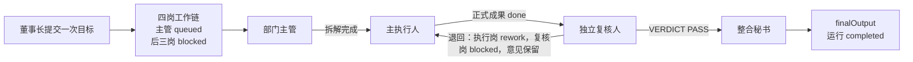

岗位状态实际会写成：`blocked`、`queued`、`doing`、`done`、`rework`。运行状态是 `planning`、`active`、`rework`、`completed`。归档是单独的 `archived`，不是第五个岗位。

准备材料、写作门、暂停和重试都挂在这条链上，但准备接力本身不把正式岗位标完成。

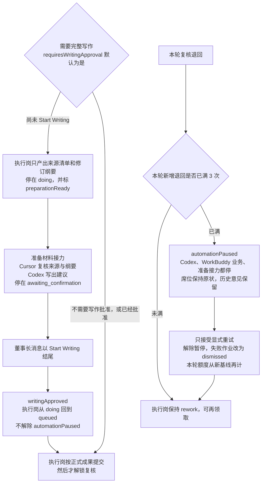

自动接力还有这些边界：

- 服务每 5 秒看 Codex、外部执行和准备接力；每 2 秒看群聊。已失败的岗位作业不会自动再跑。
- 服务重启把进行中的 Codex、外部执行、准备接力、群聊回复标为中断，并把仍处于 `doing` 的岗位放回 `queued`。
- 同一项目 Codex 正忙时，该项目的后续部门接口返回 409。
- `model-execute` 走模型路由，也会改岗位；模型失败时，已经开始的状态仍留在台账。
- 页面上的人工回填，以及 `agent-client.js` 的 claim / submit，走的是岗位动作接口，会改席位。它是手动兼容通道，不是默认的每小时队列。
- 退回次数数的是该次运行 `discussion` 里以「退回返工：」开头的记录，不是群聊消息。达到上限后的显式重试会记下新的计数基线，旧意见仍留在讨论里。

项目房间里还有两套容易看混的记录：

| 记录 | 放在哪里 | 作用 |
| --- | --- | --- |
| 阶段讨论 `discussion` | 单次运行内部 | 目标、阶段产出、退回意见；暂停额度看这里 |
| 项目消息 `projectMessages` | 台账顶层 | 房间里的目标、派工、回复、系统说明 |
| 运行内成果路径 `run.artifacts` | 单次运行内部 | 阶段提交时附带的材料路径 |
| 协作成果 `artifacts` | 台账顶层 | 单独登记的成果名称、版本、复核状态 |

## 3. 这些动作不推动岗位

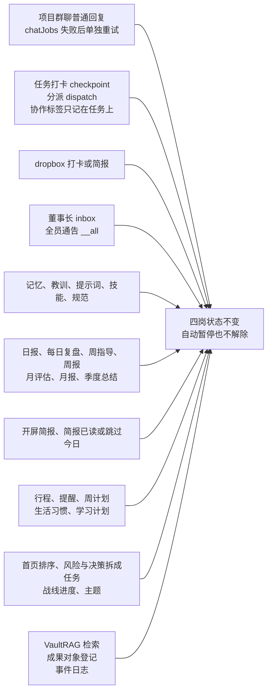

协作标签只是任务上的文字：`lead` 主控、`collab` 协作、`split` 分头、`lead-review` 主控加复核。它不创建四个岗位。

群聊的边界：

- 只有董事长消息带 `chat: true` 才排队回复。不带这个字段就只保存留言。
- 正文里的 `@codex`、`@cursor`、`@workbuddy` 优先于选择框。不指名时默认 Codex。`everyone` 要求项目里确有这三名成员。
- 回复写入 `projectMessages.replyTo`，不改阶段、不查原件、不派正式任务、不解除暂停、不代替复核。
- WorkBuddy 讨论和业务共用 `data/workbuddy-queue`。业务暂停时仍可领取讨论；已有领取占用时等待。
- 同一成员同时只有一个回复作业。成员回复不会再叫醒其他成员。

指令和岗位席位不是同一条通道：

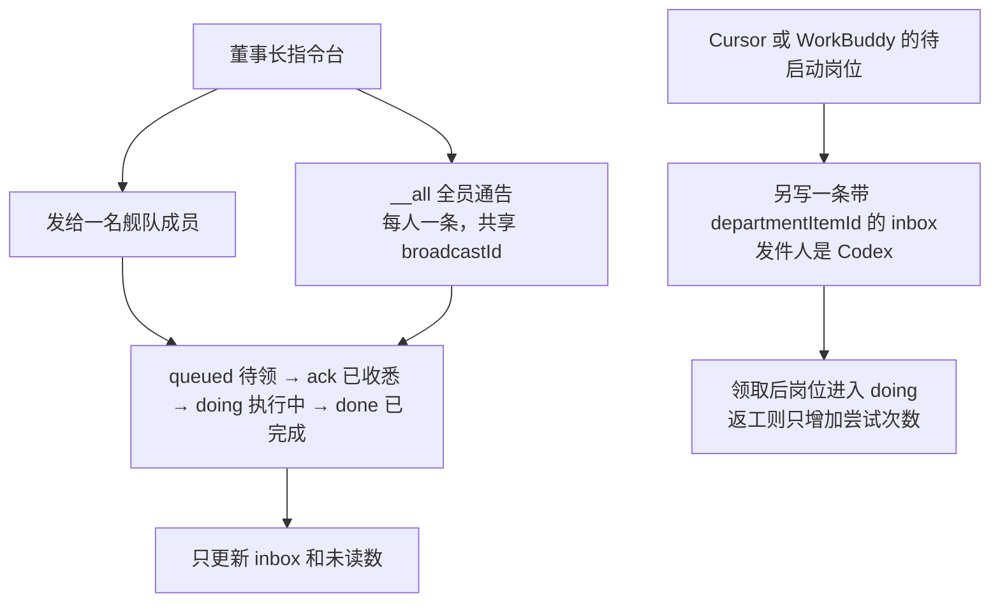

Codex 的主管、复核、整合不走这条领取，而走 `codexJobs`。豆包、DeepSeek、Docker、Ollama 可以收董事长指令，但不会被自动放上四个席位。

打卡 `POST /api/checkpoint` 和 dropbox 里的普通 JSON 只改 `tasks` 的进度、状态、下一步和备注。dropbox 约每 20 秒扫一次；成功移入 `processed/`，失败移入 `failed/` 并附 `.err.txt`。`kind: "brief"` 则进入简报中心，不建任务。

## 4. 花名册、席位、真正接通的执行器

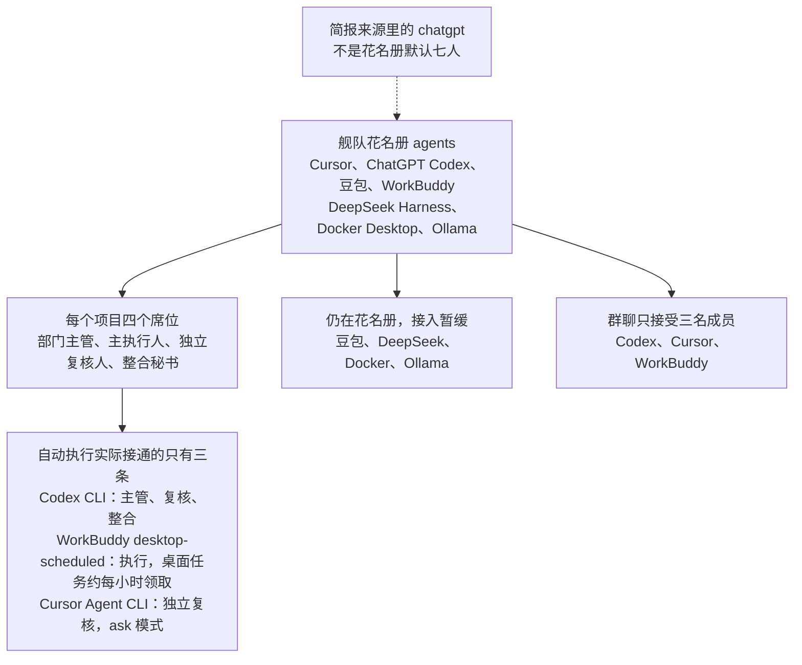

未指定成员时，选座函数的偏好顺序和上图不同，见文末差异。WorkBuddy 还有 `desktop-ui` 和 `cli` 两种传输值；默认生产通道是 `desktop-scheduled`。

Cursor 复核恢复脚本 `scripts/cursor-review-recovery.js` 会领取复核席、调用已登录的 Cursor CLI，再把通过或退回写回岗位。它不绕过写作门。

## 5. 台账里有什么，什么只活在文件里

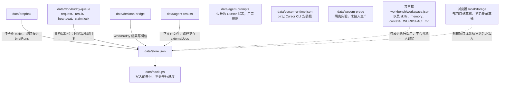

台账里的主要集合：

| 集合 | 页面或用途 | 会不会推动四个岗位 |
| --- | --- | --- |
| `departmentRuns`、`departments` | 虚拟部门 | 会 |
| `codexJobs`、`externalJobs` | Codex 与 Cursor、WorkBuddy 作业 | 会，在对应岗位写回时 |
| `chatJobs`、`projectMessages` | 项目群聊 | 普通回复不会；Start Writing 会开写作门 |
| `tasks` | 业务项目、首页风险与决策、打卡、分派 | 不会 |
| `inbox` | 舰队指令；其中带席位编号的才是岗位派工 | 董事长指令不会；席位领取会 |
| `specs` | 规范与对照清单 | 不会 |
| `memories`、`lessons`、`prompts`、`skills` | 资产中心 | 不会。页面可新增提示词；记忆和教训主要由接口写入 |
| `reports` | 工作报告 | 不会 |
| `plans`、`agendas` | 周计划、每日行程 | 不会 |
| `briefingRecipes`、`briefSources`、`briefRuns` | 开屏简报、简报中心 | 不会 |
| `agents`、`modules`、`fronts` | 舰队、指挥舱、工作学习生活战线 | 不会 |
| `lifeSystem` | 生活银河习惯、学习银河计划 | 不会。生活行程仍用 `agendas` |
| `events` | 各类动作留痕 | 不会 |
| `remote` | 模型路由、资料库、提醒、发件箱 | 不直接推动；`model-execute` 调用模型时会推动 |
| `domains` | 经营报告按领域取名 | 不会 |
| `pipeline`、`sessions` | 默认数据里的七步心智和一次搭建摘要 | 服务和页面都不读 |
| `artifacts` | 项目成果登记 | 不会改岗位状态 |

开屏简报四份配方是：经营简报、舰队简报、工作 / 学习 / 生活、跨 Agent 简报。跨 Agent 默认四个来源：Daily Priority Briefing、Guangdong Construction Brief、Practical AI Research、每日 AI 新闻推送。相同 `externalRunId` 或相同内容指纹会去重。

经营报告七类是：日报 `daily`、每日复盘 `retro`、周指导 `guidance`、周报 `weekly`、月评估 `assessment`、月报 `monthly`、季度总结 `quarterly`。初稿从任务和教训生成，人再改。`node cli.js` 只能只读打印 brief、tasks，以及周报、月报、复盘。

催报黄灯只是显示：进行中或待核验的任务 24 小时没有打卡，舰队成员 48 小时没有 `lastSync`。Agent 中心的刷新只读取台账，不修改 `lastSync`；历史同步距今时间不作为实际在线或执行证明。WorkBuddy 的暂停与队列心跳分别标注来源，只有用户明确恢复才继续。重点行程另有开始前 12 小时的提醒，提醒配置在 `remote.reminder`，默认未启用。

模型路由在 `remote.llm`，默认不启用。它服务于决策台拆解、行程报告草稿、学习计划草稿和 `model-execute`。三成员自动链不走这条路由：Codex 用本机 ChatGPT CLI，Cursor 用 Agent CLI，WorkBuddy 用桌面队列。

VaultRAG 只在启用时做只读检索。主管拆解时检索失败仍可继续，并声明没有核验原件；复核阶段检索失败则该次作业失败。检索片段不能当成已经完成的事实。

Slack 与 Telegram 只有配置位和发件箱，`enabled` 为假，不假装已经发出。企微脚本是隔离的合成试验，文档记录为尚未发送、不能替换定时队列。

共享工作区在工作台目录的上两级，登记项目目录和共享 skills、memory、context。它提示成员先读共享层，不把项目事实写进共享记忆，也不是把各 Agent 的私人目录公开。

## 6. 左栏页面各自读哪一块

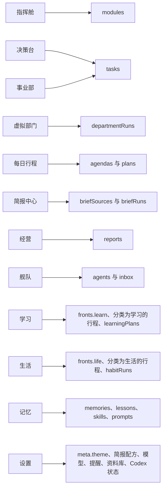

决策台的风险来自任务的阻塞、逾期和 24 小时未打卡。AI 拆解先给人看，确认后才写成新任务，不创建虚拟部门运行。

## 7. 会改变这张图的文档与代码差异

- 指定三名成员时，席位按 Codex、WorkBuddy、Cursor、Codex。不传成员时，`chooseAgent` 的偏好是主管 Ollama / DeepSeek / Cursor / WorkBuddy，执行 Codex / Cursor / WorkBuddy / Ollama，复核 DeepSeek / Ollama / Cursor / 豆包，整合 WorkBuddy / 豆包 / Ollama / Cursor。这和 `AGENTS.md` 写的默认三成员分工不是同一条路径。
- `AGENTS.md` 把群聊概括为不改变阶段。代码里，普通 `chat: true` 回复确实不改变阶段；但同一消息接口中，董事长正文以 `Start Writing` 结尾会批准写作，并在准备材料已返回且执行岗仍是 `doing` 时把执行岗改回 `queued`。它不解除自动暂停。交接文档第 03 篇已经把这个例外写出，图按代码绘制。
- 交接文档写显式重试不重置累计退回计数。累计意见确实还在 `discussion` 里；若当时已经因为满 3 次而暂停，重试会把本轮计数基线抬到当前累计，使旧退回不再占满新的 3 次额度。图按这个行为绘制。

## 8. v0.10 归档、语言与说明

新增功能于 2026-10-12 按用户 Confirm Development 实施。前七节保留原有流程分析；本节补充归档对流程的约束。

每个板块的“管理与归档”使用同一台账的原始记录，日常页面只隐藏已归档记录。模块与绑定任务、项目与指令/消息/成果/执行记录会显示关联预览后共同归档；先前独立归档的记录不会被另一条恢复操作误恢复。归档不删除正文、不修改完成进度，也不意味着已验收。批量选择每次最多 200 条。

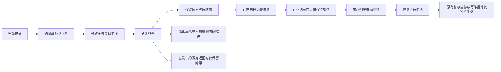

归档日程停止提醒；归档习惯模板停止后续生成；归档简报来源停止本工作台后续收件资格。各 Agent 软件里的会话、外部定时任务和原始文件由原工具管理，本功能不会删除它们。已经发出的调用不承诺强制终止，其迟到成果保存为 held，在执行记录或项目的迟到结果字段中可读，不解锁下一岗位。

设置的语言选项保存到 meta.language，允许 zh-CN/en。只翻译系统界面和使用说明，动态业务内容、分类值、状态码与路径保持原文。说明页读取本文件或英文对应文件，并使用本地 Mermaid 资源绘图；后端仅允许这两份文件，不公开整个 docs 或任意本机路径。

说明入口：[设置 → 使用说明](http://127.0.0.1:3780/#set/help)。英文对应文档：[Type 1 workbench logic](workbench-logic-type1.en.md)。功能验收规范：[SPEC-v0.10](SPEC-v0.10-archive-language-help.md)。

## 文件交付验收补充

新项目明确选择正文交付或文件交付。文件项目的顺序为：主管明确要求 → 执行正文 → 工作台确定性导出 Word → 独立复核内容与实际文件 → 整合交付清单 → 再次核验文件哈希与源版本 → 交付完成。项目房间显示实际路径、大小、版本及复核结果。正文通过、桥接 JSON 收到、四阶段完成均不能代替文件验收。文件被修改、删除或源稿变化后核验失效；重试不覆盖旧版，也不重新调用正文写作。历史正文阶段和普通群聊的权限边界保留。

## 导航与后续扩展（2026-10-18）

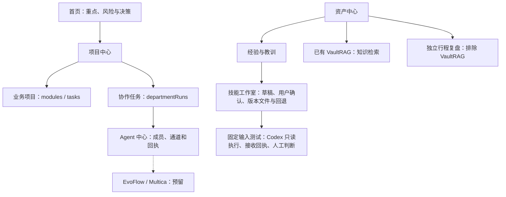

`GET /api/extensions` 只读展示能力清单。预留不表示已经安装、登录或可执行；不会启动外部服务。普通 inbox 指令只登记，正式项目任务与项目群聊使用既有执行队列。接口契约见 `docs/扩展接口约定.md`。

技能工作室使用 `skillLibrary`、`skillCases`、`skillRuns` 与实际 Markdown 版本文件；原 `skills` 说明卡保留。固定输入测试不领取业务阶段、不改变任务完成状态，接收回执与人工判断分开；WorkBuddy 保持暂停，复盘笔记继续独立于 VaultRAG。详见 `docs/SPEC-skill-studio.md`。

## 第二迭代：执行治理与阶段技能（2026-10-18）

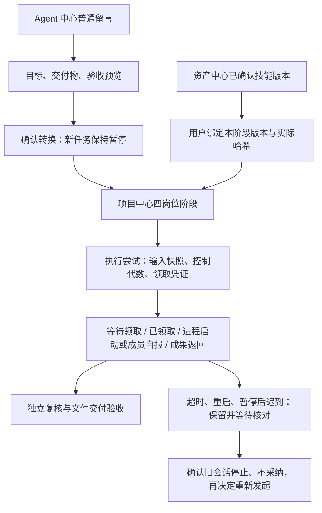

项目房间的“执行记录与技能”和 Agent 中心的“最近执行尝试”引用同一台账，不以成员登记、进程启动或自报代替完成。未核实的历史细分状态保持未知；刷新只读取。每成员同时最多一项有效调用，同一输入最多三次，独立复核沿用原有三次退回预算。暂停再恢复不收编旧结果；明确核对也不会自动再次执行。

WorkBuddy 仍为用户主动暂停，定时任务没有恢复。技能注入只针对明确选择的阶段版本，不改全局规则；真实调用回执与实际采用仍需分别核查。具体接口、验证证据与限制见 [执行治理规范](SPEC-execution-governance.md)。知识库可视化和 VaultRAG 自动启动留在后续范围。
